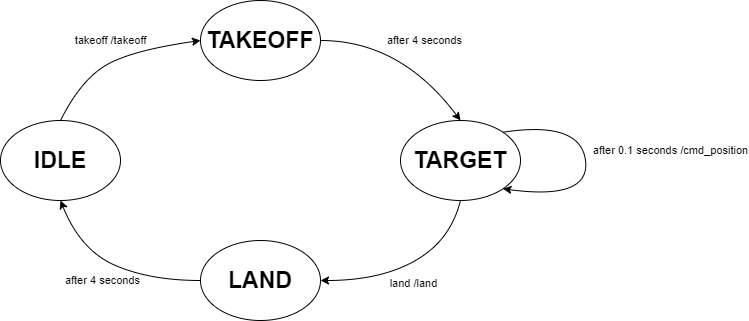

.. _safeflie:

Safeflie
########

You have now learned how to control a connected crazyflie using the high level commander.

A big problem of the high level commander inside the crazyflie is the limited supported update rate when sending go_to commands. 
These should ideally not be sent out faster than the commanded trajectory can complete. 
The Safeflie tries to mitigate this by using the high level commander only for takeoff and landing, while during flight the low level command `cmd_position` is used. This however has to be sent continously while flying and the transitions between the two command modes have to be handled carefully.

The Safeflie allows to safely switch between the high level commander and the low level commander.
It continuously sends low level setpoints at 10 Hz towards the latest target and handles the transitions for takeoff and landing.
It provides five topics, where ID is the Crazyflie ID: 

* ``/safeflieID/takeoff``
* ``/safeflieID/land``
* ``/safeflieID/send_target``
* ``/safeflieID/takeoff_to``
* ``/safeflieID/land_to``

``takeoff`` and ``land`` use ``std_msgs/msg/Empty``. Their default target heights
are 1.0 m and 0.0 m, respectively. 
During flight, targets can be sent using the `send_target <https://github.com/DynamicSwarms/ds-crazyflies/blob/master/src/crazyflies_interfaces/msg/SendTarget.msg>`_ topic:

.. code-block:: text
    :caption: SendTarget.msg

    geometry_msgs/Point target # Target position

With the `takeoff_to` and `land_to` topics, takeoff and landing to a specific height can be commanded (they are of the type `std_msgs/msg/Float32`).

Start your first Safeflie
-------------------------

Start the framework in a terminal with the workspace sourced:

.. code-block:: bash

    source install/setup.bash
    ros2 launch crazyflies framework.launch.py backend:=simulation

.. note::
    Safeflie automatically adds the Crazyflie to the selected gateway.
    Do not add the same Crazyflie through RQT or a service call beforehand.

Then in a new terminal you can start a Safeflie with:

.. code-block:: bash

    source install/setup.bash
    ros2 launch crazyflies safeflie.launch.py id:=231 type:=SIMULATION \
      channel:=80 initial_position:="[0.0,0.0,0.0]" tracked:=false

* **id**: The Crazyflie ID. The example uses 231, so its topics start with ``/safeflie231``.
* **type**: ``HARDWARE`` or ``SIMULATION``. Use ``HARDWARE`` for SITL.
* **channel**: The radio channel for hardware and SITL; ignored by the lightweight simulation.
* **initial_position**: Initial position as ``[x,y,z]`` in metres, also used to place a simulated Crazyflie.
* **tracked**: Set to ``true`` for external tracking. Leave ``false`` for the lightweight simulation or internally tracked hardware (Lighthouse/Loco).

Controlling the Safeflie
------------------------

Wait until position updates are available before takeoff. In another terminal,
source the workspace and publish a takeoff command:

.. code-block:: bash

    source install/setup.bash
    ros2 topic pub --once /safeflie231/takeoff std_msgs/msg/Empty '{}'

Wait at least four seconds for takeoff to finish. Then send an absolute target
position in metres, in the same frame as :doc:`/position_topics`:

.. code-block:: bash

    ros2 topic pub --once /safeflie231/send_target crazyflies_interfaces/msg/SendTarget \
      "{target: {x: 0.0, y: 0.5, z: 1.0}}"

Safeflie continues streaming setpoints towards the latest target; your application
does not need to republish an unchanged target. Once the movement is complete,
land with:

.. code-block:: bash

    ros2 topic pub --once /safeflie231/land std_msgs/msg/Empty '{}'

Allow four seconds for landing to finish before requesting another takeoff.

For a custom controller, see :doc:`API Documentation </api>`.
